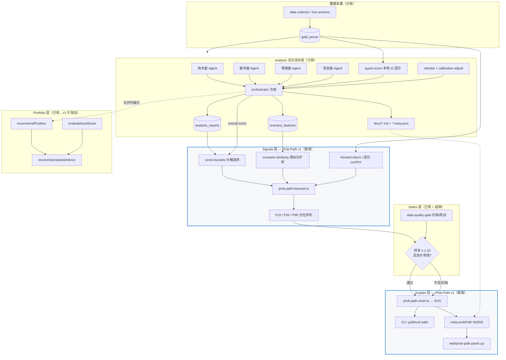
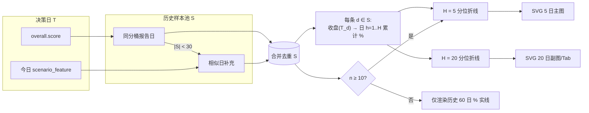
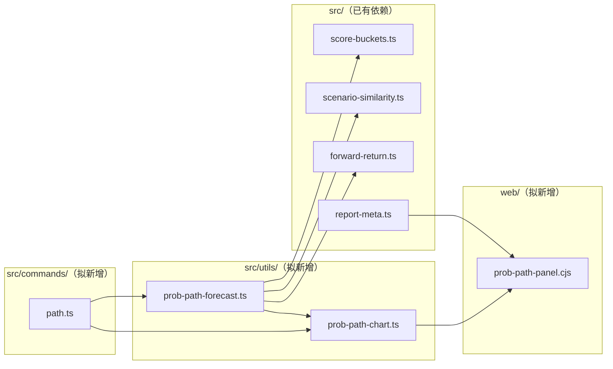
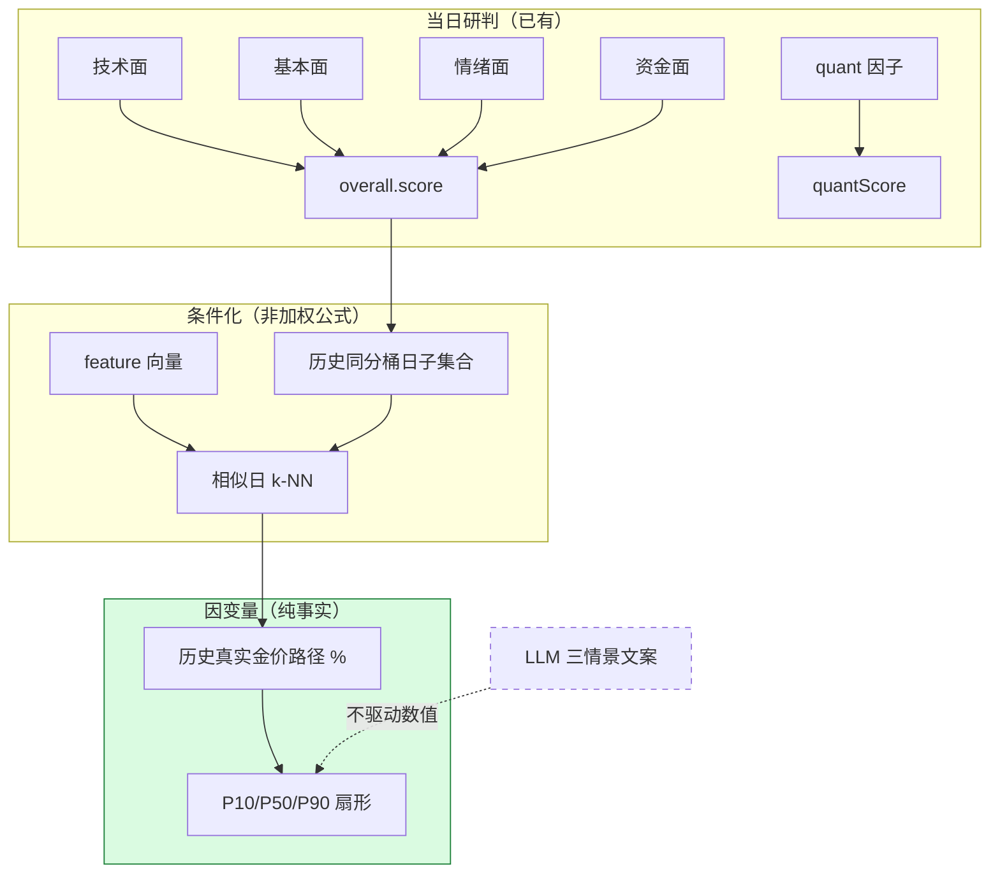

# 概率路径扇形图（Prob Path Fan）— 架构图

> 功能包：**L — Prob Path Forecast v1.0**  
> 配套：[`PROB-PATH-FORECAST-V1.md`](./PROB-PATH-FORECAST-V1.md) · [`PROB-PATH-FORECAST-RESEARCH.md`](./PROB-PATH-FORECAST-RESEARCH.md) · [`PROB-PATH-META-SCHEMA.md`](./PROB-PATH-META-SCHEMA.md)  
> 图例：实线框 = 已有模块；虚线框 = v1 拟新增；`[(DB)]` = SQLite 表

---

## 1. 总览：在 GoldRush 四层中的位置

下图为 **端到端架构**：从当日 `analysis` 产出的信号，到 **经验条件分位路径**，再经 **门禁** 到 **Explain 出图**。  
**Portfolio 层 v1 不接入**（仓位仍只由 `recommendPosition` / 短期档决定）。

**读图要点**

| 箭头含义 | 说明 |
|----------|------|
| 四面 LLM → `overall` | 进入 **分桶条件**，不直接画扇形数值 |
| `scenario_features` → 相似日 | 分桶 \|S\| &lt; 30 时扩样；特征含技术/宏观/情绪/资金 |
| `gold_prices` → cumPct | 扇形 **唯一价格真相源**；LLM 情景价 **不进** 主图 |
| Gates → Chart | n&lt;10：**仅历史 % 线**；红档：**扇形 + 降级图例** |
| Portfolio 虚线 | 概率路径 **不修改** 仓位公式；与操作建议 **并列** |

---

## 2. 算法流水：样本瀑布与双视野（5d / 20d）

常量（与 [`PROB-PATH-FORECAST-V1.md`](./PROB-PATH-FORECAST-V1.md) 一致）：

- `TARGET_SAMPLE = 30`（分桶不足则扩相似日）  
- `MIN_SAMPLE = 10`（低于此不画未来扇形）  
- 分位：**P10 / P50 / P90**（每个交易日 h 一组）

---

## 3. 模块与文件映射（实现清单）

| 产出路径 | 说明 |
|----------|------|
| `docs/goldrush-prob-path-5d-latest.svg` | CLI 默认 5 日扇形 |
| `docs/goldrush-prob-path-20d-latest.svg` | 20 日扇形 |
| `docs/goldrush-analysis-YYYY-MM-DD.meta.json` | 字段 `probPath`（双视野序列 + n + 条件说明） |

---

## 4. 与「三面 + 量化」的信息边界（防误读）

---

## 5. 变更记录

| 日期 | 说明 |
|------|------|
| 2026-11-26 | 初版：总览四层图、样本瀑布、模块映射、信息边界图 |
| 2026-11-26 | 链入 V1 / RESEARCH / ROADMAP |