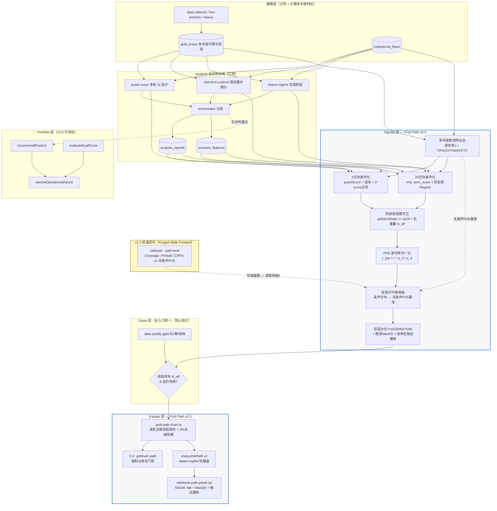

# 概率路径扇形图（Prob Path Fan）— 架构图（v2.0 升级版）

> 功能包：**包 O — Prob Path Forecast（v1 骨架 → v2.0 升级）**  
> 配套：[`PROB-PATH-FORECAST-V1.md`](./PROB-PATH-FORECAST-V1.md) · [`PROB-PATH-FORECAST-RESEARCH.md`](./PROB-PATH-FORECAST-RESEARCH.md) · [`PROB-PATH-META-SCHEMA.md`](./PROB-PATH-META-SCHEMA.md) · [`PROB-PATH-V1.1-EVAL.md`](./PROB-PATH-V1.1-EVAL.md)  
> 图例：实线框 = 已有/升级模块；`[(DB)]` = SQLite 表

---

## 1. 总览：在 GoldRush 四层中的位置

下图为 **v2.0 端到端架构**：实现 **5 日 / 20 日分轨条件化**、**多年度客观行情特征池**、**FHS 波动率归一化** 与 **经验贝叶斯收缩**，经真实 **Gates** 校验后输出至 **Explain**。  
**Portfolio 层仍不接入**（仓位继续由 `recommendPosition` / 短期档决定，与扇形并列展示）。



---

## 2. 算法流水：分轨采样 + 防泄漏 + FHS + 收缩

```mermaid
flowchart LR
  subgraph today["决策日 T (spot, σ_0)"]
    Q5[5日轨: quantScore + 当日特征]
    M20[20日轨: mid_term_score + Regime]
  end

  subgraph sample["独立样本筛选（不混池）"]
    S5[满足 endDate(d,5) <= T]
    S20[满足 endDate(d,20) <= T]
  end

  Q5 --> S5
  M20 --> S20

  S5 & S20 --> DIST[Z-score 加权欧氏距离<br/>核心权重: TIPS/DXY/趋势/波动]
  DIST --> DEOV[去重叠降权 → 计算 N_eff]
  DEOV --> SCALE[FHS 波动率缩放<br/>r_hat(h) = r(h) * σ_0 / σ_d]
  SCALE --> MIX[经验贝叶斯收缩<br/>λ = K / (N_eff + K)]

  UNCOND[无条件多年度 FHS 基准] --> MIX

  MIX --> OUT1[P10 / P25 / P50 / P75 / P90]
  MIX --> OUT2[路径 MaxDD P50 / P90]
  MIX --> OUT3[结构位首达概率]
```

关键工程守恒规则：

1. **坐标零点守恒**：历史段纵轴为 `(close(t) / spot - 1) * 100`，确保 `t = T` 严格为 `0%`，消除 v1 历史线断崖跳空 bug。
2. **文件隔离守恒**：`meta.svgRel` 永远指向按日期命名的 `goldrush-prob-path-{5,20}d-YYYY-MM-DD.svg`，历史报告永不被覆盖。
3. **时间因果守恒**：任何候选样本 $d$ 必须满足路径完整落于 `T` 之前（`endDate(d, H) <= T`），保证实时运行与 Walk-Forward 回测完全同构。
4. **门禁守恒**：`analysis` 与 `goldrush path` 共用同一门禁读取逻辑，绝不硬编码 `gateActionable: true`。

---

## 3. 模块与文件映射

| 模块 | v2.0 职责变更 |
|------|---------------|
| `src/utils/prob-path-types.ts` | 升级至 `schemaVersion: 2`（分轨 `condition`、`fhs`、`p25/p75`、`pathRisk`、`effectiveSampleSize`、`shrinkageWeight`） |
| `src/utils/prob-path-forecast.ts` | 重构内核：5/20 分轨、多年度客观特征池、严格 `endDate <= asOf`、FHS 波动缩放、Z-score 加权距离、去重叠 $N_{\text{eff}}$、向无条件 FHS 收缩、路径 MaxDD、动态结构位与触达概率、历史段 `spot` 归零 |
| `src/utils/prob-path-chart.ts` | 浅色 Web 主题适配、P25–P75 + P10–P90 双层扇形、无条件 FHS P50 对照虚线、右侧标签防裁切 |
| `src/utils/prob-path-attach.ts` | `meta.svgRel` 改为绑定按日期命名的 SVG 文件 |
| `src/commands/path.ts` | 接入真实 `data-quality-gate`，移除硬编码 `gateActionable: true` |
| `web/prob-path-panel.cjs` | 兼容 v1/v2 schema；支持 5日/20日清晰切换、展示 $N_{\text{eff}}$ / 收缩比例 / MaxDD / 结构触达概率 |
| `src/utils/prob-path-eval.ts`（v2.1 新增） | `calibrate --path-eval`：Purged Walk-Forward 覆盖率、Pinball Loss、CRPS 技巧分（对标无条件 FHS） |

---

## 4. 变更记录

| 日期 | 说明 |
|------|------|
| 2026-11-26 | 初版：总览四层图、样本瀑布、模块映射、信息边界图 |
| 2026-11-26 | **v2.0 架构修订（包 O）**：拆分为 5/20 双轨条件化、加入多年度客观特征池、防前视泄漏守卫、FHS 波动率缩放、经验贝叶斯收缩、路径风险与 v2.1 Purged Walk-Forward 校准闭环 |